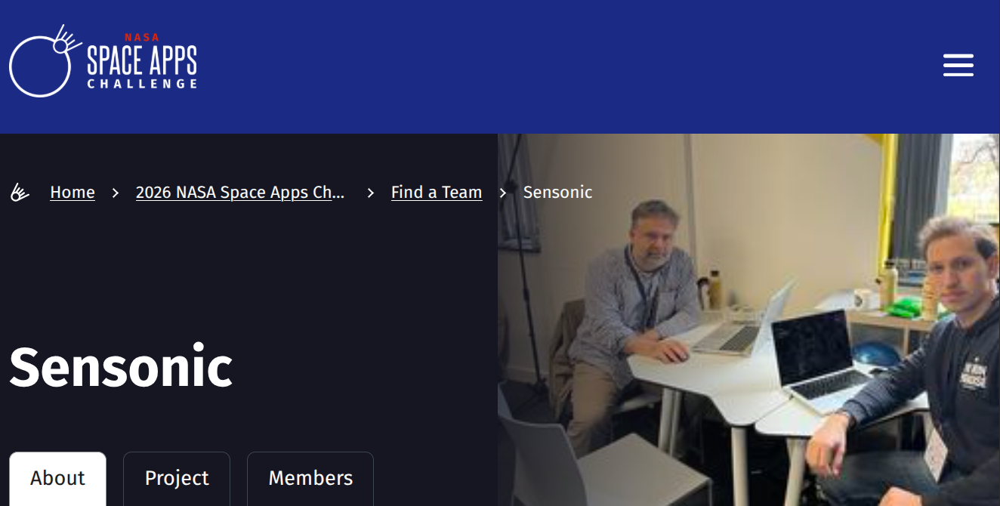

<iframe width="560" height="315" src="https://www.youtube.com/embed/vl61IMKNCr0" title="YouTube video player" frameborder="0" allow="accelerometer; autoplay; clipboard-write; encrypted-media; gyroscope; picture-in-picture; web-share" referrerpolicy="strict-origin-when-cross-origin" allowfullscreen></iframe>

Try

1. pip install -r requirements.txt
2. streamlit run app.py
3. Open image.png
4. Explore with mouse cursor

Consider for exhibit rooms

